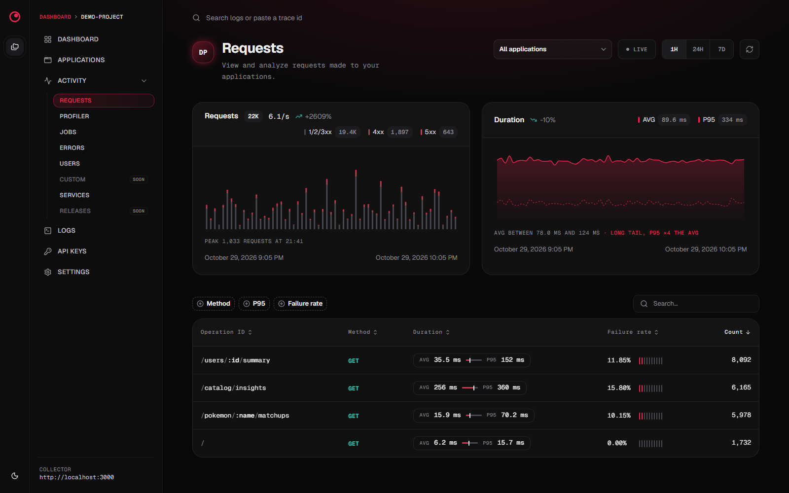

<p align="center">
  
</p>

<h1 align="center">selfhosted-nestjs-observe</h1>

<p align="center">
  A self-hosted collector and dashboard for <a href="https://github.com/nestjs/observe"><code>@nestjs/observe</code></a>.<br />
  Keep your NestJS requests, jobs, errors, logs, traces and metrics on your own infrastructure, with no plan limits.
</p>

<p align="center">
  <a href="LICENSE"></a>
  <a href="https://github.com/nestjs/observe"></a>
</p>

> [!NOTE]
> Early development: expect breaking changes. This is a community project, not affiliated with the NestJS
> team. It is built with AI: most of the code and docs were written by AI coding agents, reviewed and
> directed by the maintainer.

> [!IMPORTANT]
> This project only works with **`@nestjs/observe` 0.3.20 or earlier**. Later releases may not work correctly
> with this collector, and they ship under the NestJS Observe Agent License, which only allows sending
> telemetry to NestJS Observe: pointing them at this collector would breach that license. See
> [issue #1](https://github.com/MontejoJorge/selfhosted-nestjs-observe/issues/1).



## Features

- **Drop-in collector** for the `@nestjs/observe` agent up to 0.3.20: you only change its `endpoint`.
- **Requests and jobs** with latency percentiles, error rates and a trace waterfall per execution.
- **Errors** grouped, **logs** linked to their traces, and **runtime metrics** (CPU, memory, GC, event
  loop) per instance.
- **Projects, applications and API keys**: one project per environment, one application per service.
- **Live mode**, and a single PostgreSQL database with day-partitioned telemetry and retention.

## Quick start with Docker

The image is published to the GitHub Container Registry as
`ghcr.io/montejojorge/selfhosted-nestjs-observe` (tags `latest` and each version). It runs the API and
serves the dashboard from the same port.

```sh
mkdir observe && cd observe
curl -fsSLO https://raw.githubusercontent.com/MontejoJorge/selfhosted-nestjs-observe/main/deploy/docker-compose.yml
curl -fsSL -o .env https://raw.githubusercontent.com/MontejoJorge/selfhosted-nestjs-observe/main/deploy/.env.example
# set POSTGRES_PASSWORD in .env, then:
docker compose up -d
```

Prefer to copy them by hand? Save [`deploy/docker-compose.yml`](deploy/docker-compose.yml) as
`docker-compose.yml` and [`deploy/.env.example`](deploy/.env.example) as `.env` in an empty folder.

Open the dashboard at **http://localhost:3000**. Migrations run on start. `docker compose down` stops
the stack and keeps the data (`down -v` deletes it).

| Variable                   | Default  | Description                                            |
| -------------------------- | -------- | ------------------------------------------------------ |
| `POSTGRES_PASSWORD`        | (none)   | **Required.** Database password.                       |
| `OBSERVE_VERSION`          | `latest` | Image tag, for example `v0.1.0`.                       |
| `OBSERVE_PORT`             | `3000`   | `[host_ip:]port` for the dashboard and ingest.         |
| `RETENTION_DAYS`           | `14`     | Days of telemetry to keep.                             |
| `AGGREGATE_RETENTION_DAYS` | `90`     | Days of charts and stats to keep (per-minute rollups). |

## Connect your NestJS app

1. In the dashboard, **create a project** and **add an application** for each Nest service. Its first API
   key is created with it: copy it right away, **the secret is shown only once**.
2. Set the agent's environment:

   ```sh
   OBSERVE_ENDPOINT=http://<collector-host>:3000
   OBSERVE_APP_KEY=YOUR_APP_KEY
   OBSERVE_APP_SECRET=YOUR_APP_SECRET
   ```

3. Register `ObserveModule` (the variables must be set before the app starts, e.g. `node --env-file=.env`):

   ```ts
   export const { ObserveModule, ObserveInstrument } = createObserveModule();

   @Module({
     imports: [
       ObserveModule.forRoot({
         endpoint: process.env.OBSERVE_ENDPOINT,
         appKey: process.env.OBSERVE_APP_KEY,
         appSecret: process.env.OBSERVE_APP_SECRET,
         serviceId: 'orders-api',
         forwardLogs: true,
       }),
     ],
   })
   export class AppModule {}
   ```

[`examples/nest-inventory-api`](examples/nest-inventory-api) is a complete instrumented app whose endpoints
call public APIs, so it produces multi-span traces, logs and errors to try the dashboard with.

## Security

> [!WARNING]
> The dashboard and its API (`/api/*`) have **no authentication yet**: anyone who reaches the port can
> read telemetry and manage API keys.

Keep the port on a private network or VPN, or put an authenticating reverse proxy in front of it
(oauth2-proxy, Authelia, basic auth). Agents only need `POST /applications/telemetry` and
`POST /applications/profiles`, which are protected by the application's API key, so those two paths can
bypass the proxy's login. Secrets are stored hashed and can be revoked from the dashboard.

## Development

Requires Node 22+, pnpm 10 and Docker.

```sh
cp .env.example .env
pnpm install
pnpm db:up     # PostgreSQL on localhost:5432
pnpm dev       # API on :3000 (Swagger at /api/docs), dashboard on :5173
```

Other scripts: `pnpm build`, `pnpm lint`, `pnpm typecheck`, `pnpm format` and `pnpm api:generate`
(regenerates `openapi.json` and the dashboard's client). Conventions for contributors and coding agents are
in [AGENTS.md](AGENTS.md).

Pushing a `v*` tag such as `v0.1.0` (or running the **Docker image** workflow by hand) builds the image
for amd64 and arm64 and publishes it as that tag, `v` included, and as `latest`.

## Docs

- [docs/protocol.md](docs/protocol.md): the `@nestjs/observe` wire protocol.
- [docs/adr](docs/adr): architecture decisions.
- [TODO.md](TODO.md): telemetry that is stored but not shown yet.

## License

[AGPL-3.0 with the Commons Clause](LICENSE). You may use, modify and self-host it. If you distribute it or
offer a modified version over a network, you must publish your source under the same terms. You may not
sell it, or sell hosting or support whose value comes from it.
