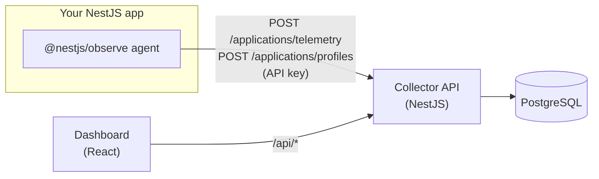

<p align="center">
  
</p>

<h1 align="center">selfhosted-nestjs-observe</h1>

<p align="center">
  A self-hosted collector and dashboard for <a href="https://www.npmjs.com/package/@nestjs/observe"><code>@nestjs/observe</code></a>.<br />
  Keep your NestJS requests, jobs, errors, logs, traces and metrics on your own infrastructure, with no plan limits.
</p>

<p align="center">
  <a href="LICENSE"></a>
  = 22" />
  
  
</p>

> [!NOTE]
> Early development: expect breaking changes. This is a community project, not affiliated with the NestJS team.

## Contents

- [Features](#features)
- [How it works](#how-it-works)
- [Quick start with Docker](#quick-start-with-docker)
- [Connect your NestJS app](#connect-your-nestjs-app)
- [Configuration](#configuration)
- [Security](#security)
- [Try it with the example app](#try-it-with-the-example-app)
- [Development](#development)
- [Project layout](#project-layout)
- [Roadmap and docs](#roadmap-and-docs)
- [License](#license)

## Features

- **Drop-in collector.** Speaks the `@nestjs/observe` wire protocol, so you only change the agent's `endpoint`.
- **Requests and jobs** with latency percentiles, error rates and a trace waterfall for each execution.
- **Errors** grouped, with counts and first/last seen.
- **Logs** forwarded by the agent, linked to their traces.
- **Traces** with the full span tree.
- **Runtime metrics per instance** (CPU, memory, GC, event loop) on the Profiler page.
- **Projects, applications and API keys.** Projects (for example one per environment) contain
  applications (one per Nest service), and each application authenticates with its own keys.
- **Live mode** that refreshes the dashboard as new batches arrive.
- **One PostgreSQL database**, with day-partitioned telemetry and retention by dropping partitions.

## How it works



The agent batches telemetry and posts it every few seconds. The API authenticates each batch with the
application's API key, stores it in PostgreSQL, and serves the query API (`/api/*`) the dashboard reads.

## Quick start with Docker

Requires Docker with Compose. The images are built from this repository, so run these from the root of
a clone:

```sh
cp deploy/.env.example deploy/.env    # then set POSTGRES_PASSWORD (required)
docker compose -f deploy/docker-compose.yml up -d --build
```

Open the dashboard at **http://localhost:8080**.

The stack in [`deploy/docker-compose.yml`](deploy/docker-compose.yml) runs three containers. Only `web`
publishes ports.

| Service    | What                                                                 | Published                                           |
| ---------- | -------------------------------------------------------------------- | --------------------------------------------------- |
| `postgres` | PostgreSQL 18, data in the `postgres-data` volume                    | no                                                  |
| `api`      | Collector and query API. Applies pending migrations on start         | no                                                  |
| `web`      | nginx: the dashboard SPA, with `/api` proxied to `api` (same origin) | `DASHBOARD_PORT` (default `8080`, container `8080`) |
| `web`      | nginx: ingest only (`POST /applications/telemetry` and `/profiles`)  | `INGEST_PORT` (default `4000`, container `8081`)    |

The ingest port answers only the two agent routes; anything else is a `404` (or `403` for a non-`POST`
method). Both port variables accept `host_ip:port`, for example `DASHBOARD_PORT=127.0.0.1:8080`.

To stop the stack:

```sh
docker compose -f deploy/docker-compose.yml down       # keeps the data
docker compose -f deploy/docker-compose.yml down -v    # also deletes the database volume
```

To build the images on their own, run from the repository root:

```sh
docker build -f apps/api/Dockerfile -t selfhosted-nestjs-observe-api:0.0.1 .
docker build -f apps/web/Dockerfile -t selfhosted-nestjs-observe-web:0.0.1 .
```

## Connect your NestJS app

1. **Create a project** in the dashboard, for example one per environment (`Shop prod`, `Shop staging`).
2. **Add an application** for each Nest service. Its first API key is created with it. Copy the
   `appKey` and `appSecret` right away: **the secret is shown only once**. You can create more keys
   later on the project's Keys page.
3. **Set the agent's environment** in the instrumented app:

   ```sh
   OBSERVE_ENDPOINT=http://<collector-host>:4000   # the ingest port
   OBSERVE_APP_KEY=obs_...
   OBSERVE_APP_SECRET=obss_...
   ```

4. **Register `ObserveModule`**, reading the options from `ConfigService` so `.env` is loaded first
   (this mirrors the [example app](examples/nest-inventory-api)):

   ```ts
   import { Module } from '@nestjs/common';
   import { ConfigModule, ConfigService } from '@nestjs/config';
   import { createObserveModule } from '@nestjs/observe';

   export const { ObserveModule, ObserveInstrument } = createObserveModule();

   @Module({
     imports: [
       ConfigModule.forRoot({ isGlobal: true }),
       ObserveModule.forRootAsync({
         inject: [ConfigService],
         useFactory: (config: ConfigService) => ({
           endpoint: config.get('OBSERVE_ENDPOINT'),
           appKey: config.get('OBSERVE_APP_KEY'),
           appSecret: config.get('OBSERVE_APP_SECRET'),
           serviceId: 'orders-api', // the instance; shown as a filter in the dashboard
           forwardLogs: true,
         }),
       }),
     ],
   })
   export class AppModule {}
   ```

Batches without a valid, active key are rejected with `401`. Data appears in the dashboard within a few
seconds of the first request.

> [!TIP]
> The credential snippet in the dashboard uses the dashboard's own origin as `OBSERVE_ENDPOINT`. That
> works too, since nginx also proxies the two ingest routes on the dashboard port. If you put the
> dashboard behind an authenticating proxy, point your services at the ingest port instead.

## Configuration

### Docker stack (`deploy/.env`)

| Variable                    | Default   | Description                                                           |
| --------------------------- | --------- | --------------------------------------------------------------------- |
| `POSTGRES_PASSWORD`         | (none)    | **Required.** Database password, used by PostgreSQL and the API.      |
| `POSTGRES_USER`             | `observe` | Database user.                                                        |
| `POSTGRES_DB`               | `observe` | Database name.                                                        |
| `DASHBOARD_PORT`            | `8080`    | `[host_ip:]port` for the dashboard and the query API.                 |
| `INGEST_PORT`               | `4000`    | `[host_ip:]port` for the ingest routes. Use it as `OBSERVE_ENDPOINT`. |
| `OBSERVE_VERSION`           | `0.0.1`   | Tag of the `api` and `web` images.                                    |
| `DATABASE_POOL_MAX`         | `10`      | Max connections in the API's PostgreSQL pool.                         |
| `DATABASE_MIGRATE_ON_START` | `true`    | Apply pending migrations when the API starts.                         |
| `RETENTION_DAYS`            | `14`      | Days of telemetry to keep before partitions are dropped.              |

### API (when running it yourself)

The API reads these variables (validated in [`apps/api/src/config/env.ts`](apps/api/src/config/env.ts)).
The Docker stack sets them for you.

| Variable                    | Default     | Description                             |
| --------------------------- | ----------- | --------------------------------------- |
| `API_PORT`                  | `3000`      | Port the API listens on.                |
| `DATABASE_HOST`             | `localhost` | PostgreSQL host.                        |
| `DATABASE_PORT`             | `5432`      | PostgreSQL port.                        |
| `DATABASE_USER`             | `observe`   | PostgreSQL user.                        |
| `DATABASE_PASSWORD`         | `observe`   | PostgreSQL password.                    |
| `DATABASE_NAME`             | `observe`   | PostgreSQL database.                    |
| `DATABASE_POOL_MAX`         | `10`        | Max connections in the pool (1 to 200). |
| `DATABASE_MIGRATE_ON_START` | `true`      | Apply pending migrations on start.      |
| `RETENTION_DAYS`            | `14`        | Days of telemetry to keep (1 to 3650).  |

The dashboard takes `VITE_API_URL` at build time (default `http://localhost:3000`). The Docker image
builds it empty, so the dashboard calls its own origin.

## Security

> [!WARNING]
> The dashboard and the query and management API (`/api/*`) have **no authentication yet**. Anyone who
> can reach the dashboard port can read your telemetry and create or delete API keys.

- Keep `DASHBOARD_PORT` on a private network or VPN, or put an authenticating reverse proxy in front of
  it (oauth2-proxy, Authelia, basic auth on your ingress). Binding it to `127.0.0.1:8080` and proxying
  from there is a simple start.
- Expose only `INGEST_PORT` to the services you monitor. Ingest is protected by per-application API keys.
- API key secrets are stored hashed (SHA-256) and shown only once. Revoke or delete a key from the
  dashboard to cut off an agent.

## Try it with the example app

[`examples/nest-inventory-api`](examples/nest-inventory-api) is a small NestJS app already instrumented
with `ObserveModule.forRootAsync`. Its endpoints (`GET /users/:id/summary`, `GET /pokemon/:name/matchups`,
`GET /catalog/insights`) call public APIs, so they produce multi-span traces, logs and errors (404, 400
and 500 on demand).

Create an application in the dashboard, copy `examples/nest-inventory-api/.env.example` to `.env`, fill
in `OBSERVE_APP_KEY`, `OBSERVE_APP_SECRET` and `OBSERVE_ENDPOINT`, and start it. See
[its README](examples/nest-inventory-api/README.md) for the endpoints and sample `curl` calls.

## Development

Requires Node 22+, pnpm 10 and Docker. Always use pnpm.

```sh
cp .env.example .env
pnpm install
pnpm db:up     # PostgreSQL via docker compose, on localhost:5432
pnpm dev       # api + web in watch mode
```

| App             | URL                                               |
| --------------- | ------------------------------------------------- |
| API / collector | http://localhost:3000 (Swagger UI at `/api/docs`) |
| Dashboard       | http://localhost:5173                             |

In development, point agents at `OBSERVE_ENDPOINT=http://localhost:3000`.

| Script              | What                                                            |
| ------------------- | --------------------------------------------------------------- |
| `pnpm dev`          | API and dashboard in watch mode (`dev:api` / `dev:web` for one) |
| `pnpm build`        | Build both apps                                                 |
| `pnpm lint`         | oxlint                                                          |
| `pnpm typecheck`    | Type-check both apps                                            |
| `pnpm format`       | Prettier (`format:check` to verify)                             |
| `pnpm api:generate` | Regenerate `openapi.json` and the dashboard's API client        |
| `pnpm db:down`      | Stop the development database                                   |

Run a script in one app with `pnpm --filter api <script>` or `pnpm --filter web <script>`. Contributor
and agent conventions are in [AGENTS.md](AGENTS.md).

## Project layout

| Path                                   | What                                                |
| -------------------------------------- | --------------------------------------------------- |
| [`apps/api`](apps/api)                 | NestJS collector and query API (Kysely, PostgreSQL) |
| [`apps/web`](apps/web)                 | Vite + React dashboard                              |
| [`deploy`](deploy)                     | Production Docker Compose stack                     |
| [`examples`](examples)                 | Instrumented sample apps                            |
| [`docs/protocol.md`](docs/protocol.md) | The `@nestjs/observe` wire protocol                 |
| [`docs/adr`](docs/adr)                 | Architecture decision records                       |

## Roadmap and docs

- [TODO.md](TODO.md): telemetry the collector stores but does not show yet (custom metrics, CPU
  profiles as flame graphs, a spans/dependencies view).
- [docs/protocol.md](docs/protocol.md): the wire format, reverse-engineered from `@nestjs/observe`.
- [ADR 0001](docs/adr/0001-storage.md): why PostgreSQL is the only store.
- [ADR 0002](docs/adr/0002-application-scoping.md): how projects, applications and API keys scope telemetry.
- [apps/api/README.md](apps/api/README.md) and [apps/web/README.md](apps/web/README.md): per-app details.

## License

[MIT](LICENSE)
