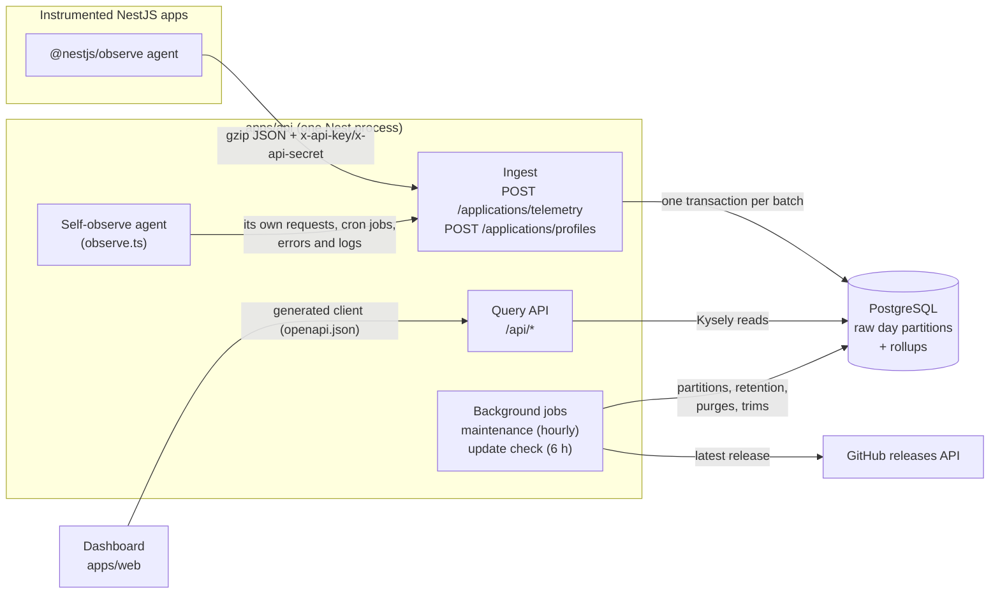
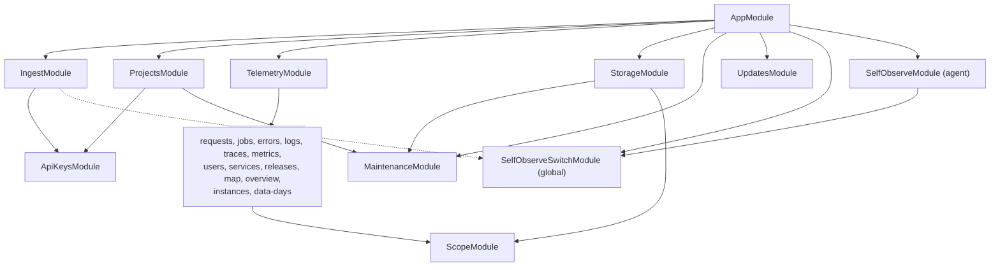
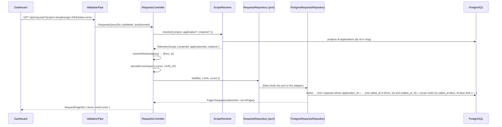
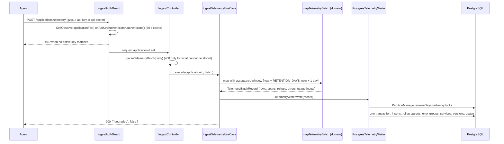

# Backend architecture (`apps/api`)

This page is for a developer joining the project who wants a mental model of the API before reading
its code. It explains how `apps/api` is put together and why. It summarizes the decisions recorded
elsewhere and links to them instead of repeating them:

- [docs/protocol.md](../protocol.md): the `@nestjs/observe` wire protocol (what the agent sends and
  which responses it understands).
- [docs/adr/](../adr/): the architecture decision records, `0001` to `0009`.
- [apps/api/AGENTS.md](../../apps/api/AGENTS.md): the working rules (commands, env table, query
  conventions, OpenAPI rules). It is the reference; this page is the tour.

## Big picture

The API is two things in one NestJS 12 process (ESM, Express, Kysely over `pg`):

1. **A collector.** Apps instrumented with `ObserveModule` from `@nestjs/observe` point their
   `endpoint` at us. Their agent POSTs gzip JSON batches to `/applications/telemetry` and profile
   windows to `/applications/profiles`. We authenticate the batch, map it to rows, and write it to
   PostgreSQL in one transaction, updating the rollup tables in the same transaction.
2. **A query API** under `/api`, read by the React dashboard (`apps/web`): telemetry views,
   management of projects, applications and API keys, storage, settings.

Everything lives in a single PostgreSQL database ([ADR 0001](../adr/0001-storage.md)): no
Tempo, Loki or TimescaleDB, so self-hosting is "one container plus Postgres". When `DASHBOARD_DIR`
is set (as in the Docker image), the same process also serves the built dashboard from `/`
(`src/dashboard.ts`).

The collector also observes itself: it runs the same `@nestjs/observe` agent and, when enabled,
sends its own telemetry to its own ingest route (see [Self-observe](#self-observe)).

## Module map

`src/` is organized by feature. Each folder is a Nest module except `config/` (a validated class,
loaded by `ConfigModule`) and `health/` (a single controller registered on `AppModule`).

| Path                                       | Nest module(s)                                          | Owns                                                                                                                                                                                                      |
| ------------------------------------------ | ------------------------------------------------------- | --------------------------------------------------------------------------------------------------------------------------------------------------------------------------------------------------------- |
| `main.ts`, `app.module.ts`, `app.setup.ts` | `AppModule`                                             | Bootstrap: body parser (20 MB, gzip), `/api` prefix (ingest excluded), CORS, global `ValidationPipe`, Swagger UI at `/api/docs`.                                                                          |
| `config/env.ts`                            | (`ConfigModule.forRoot`, global)                        | The `Env` class: every env var, its default and its validation.                                                                                                                                           |
| `database/`                                | `DatabaseModule` (global)                               | The Kysely instance (`KYSELY` token), the typed schema, migrations, `PartitionManager`, bulk insert and cleanup helpers.                                                                                  |
| `ingest/`                                  | `IngestModule`                                          | The write side: ingest controller, auth guard, wire mapping, Postgres writers.                                                                                                                            |
| `projects/`                                | `ProjectsModule`, `ApiKeysModule`                       | Projects, applications, API keys (`/api/projects/...`). `ApiKeysModule` only holds `ApiKeyAuthenticator`, shared with ingest.                                                                             |
| `telemetry/`                               | `TelemetryModule` + one module per area                 | The read side: `instances`, `overview`, `requests`, `jobs`, `errors`, `logs`, `traces`, `metrics`, `users`, `services`, `releases`, `map`, `data-days`. `common/` holds `ScopeModule` and shared helpers. |
| `storage/`                                 | `StorageModule`                                         | Storage usage views and trim/purge requests ([ADR 0005](../adr/0005-storage-usage-and-trims.md)).                                                                                                         |
| `maintenance/`                             | `MaintenanceModule`                                     | Hourly cron (`MaintenanceService`), `ApplicationPurger`, `StorageTrimmer`.                                                                                                                                |
| `updates/`                                 | `UpdatesModule`                                         | Update check against GitHub releases ([ADR 0008](../adr/0008-update-check.md)).                                                                                                                           |
| `self-observe/`, `observe.ts`              | `SelfObserveSwitchModule` (global), `SelfObserveModule` | The self-observe switch, the boot decision and the collector's own agent ([ADR 0009](../adr/0009-self-observe.md)).                                                                                       |
| `health/`                                  | (controller on `AppModule`)                             | `GET /api/health`: `select 1`, 503 when the database is down.                                                                                                                                             |
| `openapi/`                                 | none                                                    | `createOpenApiDocument` and `generate.ts`, which writes `apps/api/openapi.json`.                                                                                                                          |

How they depend on each other (global modules, `ConfigModule` and `DatabaseModule`, are used by
almost everything and left out):

Notable edges:

- **Ingest depends on projects** only through `ApiKeyAuthenticator` (credentials to application) and
  on self-observe through `SelfObserve.applicationFor` (the in-memory credentials).
- **Projects and storage depend on maintenance**: deleting a project or application, or asking for a
  trim or a purge, queues a row and calls `ApplicationPurger.trigger()` or `StorageTrimmer.trigger()`
  so the work starts at once in the background, instead of waiting for the next hourly run.
- **`TracesModule` owns no storage**: it imports `RequestsModule`, `JobsModule` and `LogsModule` and
  composes their exported read ports.
- `projects/activity.ts` (the request activity on project and application cards) reuses the
  read-side helpers in `telemetry/common/`.

## Layering

The repo follows clean architecture (ports and adapters) where it pays off, and stays flat where it
would only add ceremony.

| Layer              | Where                                                                                                                                                                                              | Rules                                                                                                                                |
| ------------------ | -------------------------------------------------------------------------------------------------------------------------------------------------------------------------------------------------- | ------------------------------------------------------------------------------------------------------------------------------------ |
| **domain**         | `ingest/domain`, `projects/domain`, `storage/domain`, `self-observe/domain`, `updates/domain`, plus pure files such as `telemetry/releases/release-comparison.ts` and `telemetry/map/map-graph.ts` | Pure TypeScript. No Nest, no Kysely, no I/O. Wire types, mapping, rollup arithmetic, fingerprints, slugs, key hashing, semver.       |
| **application**    | `ingest/application`, `self-observe/application`, `updates/application`, the `*.service.ts` files of `projects/` and `storage/`                                                                    | Use cases and services. They depend on **ports**: abstract classes such as `TelemetryWriter`, `ProjectsRepository`, `ReleaseSource`. |
| **infrastructure** | `ingest/infrastructure`, `*/infrastructure`, every `postgres-*.ts`, `updates/infrastructure/github-release-source.ts`                                                                              | Adapters: Kysely repositories and writers, the GitHub HTTP client.                                                                   |
| **http**           | `*.controller.ts`, `*.dto.ts`, `ingest/http`                                                                                                                                                       | Controllers, DTO classes (validation and OpenAPI), the ingest guard and its light payload checks.                                    |

**Ports are abstract classes**, so they double as Nest injection tokens: a module binds them with
`{ provide: TelemetryWriter, useClass: PostgresTelemetryWriter }`, and a spec subclasses them for an
in-memory fake. This is also what keeps a future ClickHouse backend possible
([ADR 0001](../adr/0001-storage.md)): it would add adapters for the writer and read ports and leave
domain, use cases and controllers alone.

### Where the repo deviates, on purpose or not

- **The read side has no use-case layer.** Telemetry controllers call their read port
  (`RequestsRepository`, `ErrorsRepository`, ...) directly, CQRS style. A read model has no business
  rules to protect, and a pass-through use case per route would double the code.
- **DTOs cross layers.** Read ports return the DTO classes (`OperationStatsDto`,
  `RequestDetailDto`...) and repositories build them. The DTOs are the single source of truth for the
  OpenAPI contract, so mapping them again in a separate layer would buy nothing.
- **Some collaborators are concrete classes, not ports.** `ApiKeyAuthenticator`, `ScopeResolver`,
  `PartitionManager`, `ApplicationPurger`, `StorageTrimmer` and `MaintenanceService` inject `KYSELY`
  directly, and services such as `ProjectsService` depend on `ApplicationPurger` itself.
  `HealthController` runs its `select 1` on Kysely too.
- **Framework decorators in the application layer.** `UpdateChecker` (in `updates/application`) owns
  its `@Cron`.

### One request end to end

`GET /api/requests?project=shop&range=24h&status=error` (list of request executions):

The files: `telemetry/requests/requests.controller.ts`, `requests.dto.ts`, `requests.repository.ts`
(port), `postgres-requests.repository.ts` (adapter), wired in `requests.module.ts`. The shared
pieces come from `telemetry/common/`: `scope.ts`, `time-window.ts`, `cursor.ts`, `query.dto.ts`.

## Ingest pipeline

The ingest routes are a contract with a third-party agent. Read
[docs/protocol.md](../protocol.md) first, in particular
[Responses the agent understands](../protocol.md#responses-the-agent-understands): the agent
re-sends a sanitized batch once on `400`, backs off on `401`/`403`, and pauses on `429`. That is why
the code is careful about which status it returns.

1. **Body.** `main.ts` disables Nest's default body parser and registers `json` with a 20 MB limit
   and `inflate: true`, so gzip bodies are inflated from `Content-Encoding`. The ingest paths are
   excluded from the `/api` prefix in `app.setup.ts`, the one place shared with OpenAPI generation.
2. **Auth.** `IngestAuthGuard` (`ingest/http/ingest-auth.guard.ts`) reads `x-api-key` and
   `x-api-secret`. It first asks `SelfObserve.applicationFor()` whether they are the collector's own
   in-memory credentials, then `ApiKeyAuthenticator.authenticate()`. The authenticator caches every
   lookup (hit or miss) for 60 s, bounded to 10 000 entries, and compares the SHA-256 of the secret
   ([ADR 0002](../adr/0002-application-scoping.md)). Anything else is a `401`: there is no default
   application. The resolved id reaches the handler through the `@IngestApplication()` decorator.
3. **Light validation.** `ingest/http/payload-validation.ts` only rejects what cannot be stored
   (a non-object body, a bad `serviceId`, a section of the wrong type). Malformed items inside a
   section are skipped by the mapper, not rejected, so one bad snapshot never loses a whole batch.
4. **Mapping (pure).** `IngestTelemetryUseCase` calls `mapTelemetryBatch` in
   `ingest/domain/telemetry-batch.mapper.ts`. Wire types live in `ingest/domain/wire.ts` (edit them
   together with `docs/protocol.md`). The mapper drops events outside the acceptance window, stamps
   execution and log ids as **UUIDv7 with the event time** (`uuid-v7.ts`), flattens span trees in
   memory (`trace-flattener.ts`, including self time), fingerprints errors (`error-fingerprint.ts`)
   and computes the rollup rows (`rollups.ts`: `rollUpRequests`, `rollUpJobs`, `rollUpUsers`,
   `userPresence`, `rollUpSpans`, with the log-scale histogram of `latency-histogram.ts`).
5. **Write.** `PostgresTelemetryWriter.write()` first makes sure the day partitions exist
   (`PartitionManager.ensureDays`, under a transaction-level advisory lock), then runs one
   transaction:
   - append-only inserts into the raw tables (`requests`, `jobs`, `error_occurrences`, `logs`,
     `runtime_metrics`, `custom_metrics`), chunked by `insertMany` under the 65 535 bind-parameter
     limit, while `UsageTally` counts rows and estimated bytes;
   - upserts of the rollups (`requests_1m`, `jobs_1m`, `users_1h`, `user_presence_15m`,
     `span_stats_5m`): counts are added, min/max merged, histograms merged by the SQL function
     `histogram_add`;
   - upserts of `error_groups` and `error_group_culprits`, `services`, `service_versions`, then the
     application's `application_usage` rows **as the very last statement**.

   Upserts are deduplicated and sorted by key in the domain (`sortedValues`), so concurrent
   batches lock hot rows in the same order and cannot deadlock, and locks are held only until
   the commit.

6. **Reply.** Always `200 {"degraded": false}`: a self-hosted collector never asks the agent to
   degrade. Profiles (`IngestProfilesUseCase`, `PostgresProfileWriter`) store the raw windows in
   `profiles` and answer `200 {}`.

Why rollups are written at ingest, and not by a cron or TimescaleDB, is in
[ADR 0003](../adr/0003-minute-rollups.md): no watermark, no lag, plain Postgres.

## Storage model

All tables are declared in `database/database.types.ts`, which is kept in sync with the migrations
by hand. The lists that drive maintenance live there too: `PARTITIONED_TABLES`, `ROLLUP_TABLES`
and `USAGE_TABLES`.

| Kind                     | Tables                                                                                                                                                                                             | Kept for                                                                  |
| ------------------------ | -------------------------------------------------------------------------------------------------------------------------------------------------------------------------------------------------- | ------------------------------------------------------------------------- |
| Raw, day-partitioned     | `requests`, `jobs`, `error_occurrences`, `logs`, `runtime_metrics`, `custom_metrics`                                                                                                               | `RETENTION_DAYS` (default 14)                                             |
| Rollups, day-partitioned | `requests_1m`, `jobs_1m` ([ADR 0003](../adr/0003-minute-rollups.md)); `users_1h`, `user_presence_15m`, `span_stats_5m` ([ADR 0004](../adr/0004-users-and-time-breakdown.md))                       | `AGGREGATE_RETENTION_DAYS` (default 90, never less than `RETENTION_DAYS`) |
| Plain telemetry          | `services`, `service_versions` ([ADR 0006](../adr/0006-releases.md)), `error_groups`, `error_group_culprits`, `profiles`, `application_usage` ([ADR 0005](../adr/0005-storage-usage-and-trims.md)) | Deleted by time in maintenance                                            |
| Management               | `projects`, `applications`, `api_keys`, `application_purges`, `storage_trims`, `update_check`, `self_observe`                                                                                      | Forever                                                                   |

Key choices and where they are argued:

- **Day partitions** (range on the time column, UTC days, named `<table>_pYYYYMMDD`) make
  retention a `DETACH ... CONCURRENTLY` plus `DROP` instead of a bloating `DELETE`
  ([ADR 0001](../adr/0001-storage.md)). Migrations never create partitions: `PartitionManager` creates
  yesterday through three days ahead on boot and hourly, and any day a batch touches on demand.
- **No span table.** Each execution keeps its span tree as `jsonb` (`trace`), so a detail view is one
  read; spans are only flattened in memory to feed `span_stats_5m`. The `spans` table was dropped by
  migration 0009 (see the revisions of [ADR 0001](../adr/0001-storage.md) and
  [ADR 0004](../adr/0004-users-and-time-breakdown.md)).
- **Every row carries `application_id`** and no foreign key to `applications`
  ([ADR 0002](../adr/0002-application-scoping.md)): a cascade into partitions would delete row by
  row. Deletes queue the ids in `application_purges`, and `ApplicationPurger` deletes table by table
  and partition by partition, in batches (`deleteInBatches` in `database/cleanup.ts`), then runs a
  plain `VACUUM`.
- **Trims** ("keep the last N days" for a project or application) are queued in `storage_trims` and
  executed by `StorageTrimmer` the same way; rollups and error groups are not trimmed
  ([ADR 0005](../adr/0005-storage-usage-and-trims.md)).
- **Migrations** use Kysely's `Migrator` with an explicit provider (`database/migrations/index.ts`),
  because ESM dynamic imports of Windows paths break with `FileMigrationProvider` and the explicit list
  ships with the build. They run on boot (`DATABASE_MIGRATE_ON_START`) or with
  `pnpm --filter api db:migrate` (`database/migrate.ts`). Kysely's advisory lock makes concurrent
  instances safe. Never edit an applied migration.
- **Type parsing.** `create-database.ts` parses `int8` and `numeric` to JS numbers and keeps `date`
  as a `YYYY-MM-DD` string, so a UTC day never shifts to local time.

## Query side

### Scope

Every telemetry route takes `project` (id or slug) and optionally `application` (`ScopeQueryDto` in
`telemetry/common/query.dto.ts`); routes with a time range also take `instance`
(`TimeRangeQueryDto`). `ScopeResolver` turns them into a
`TelemetryScope` with one indexed query, and returns 404 when the application is not in the project,
so ids from another project never leak. Queries then filter with `inApplications()`: `=` for one
application (a plain equality on the leading index column), `in (...)` for several, `false` for none.
`instance` is the agent's `serviceId`. Indexes lead with `application_id` and then the time column,
so a scoped query is one index range per pruned partition.

### Time windows and buckets

`resolveWindow()` (`telemetry/common/time-window.ts`) turns `range` (`1h`, `3h`, `6h`, `12h`, `24h`,
`3d`, `7d`, `15d`) or a custom `from`/`to` (at most `MAX_WINDOW_DAYS` = 31 days) into a half-open
`[from, to)` window. Every query on a partitioned table filters its partition key with it, which is
what makes the planner prune partitions. `bucketSeconds()` picks the timeline width (about 100
buckets at most); timelines use `date_bin` and are gap-filled in TypeScript (`fillTimeline`). The
table of widths and the custom-window rules are in [ADR 0007](../adr/0007-time-ranges.md).

Lookups by id use the UUIDv7 timestamp: `windowFromId()` (`telemetry/common/id-window.ts`) turns
an execution or log id into a two-second window, so the lookup touches one partition.

### Rollups for stats, raw rows for lists

The rule: **stats and timelines read the rollups, lists and details read the raw rows.**

- Overview, operations, queues, services, map and the project/application cards read
  `requests_1m`, `jobs_1m` or `span_stats_5m` through `telemetry/common/rollups.ts`. One grouped query
  returns sums, min and max; a second one unnests the histograms into `(bucket, count)` cells
  (`histogramCells`); percentiles are computed in TypeScript (`rollupPercentiles`). Both run in
  parallel with `Promise.all`. `rollupWindow()` starts the read at the bucket containing `from`.
- Users need exact numbers for any window. `postgres-users.repository.ts` splits the window
  (`splitWindow`) into whole hours read from `users_1h` and at most two partial **edges** read from
  raw `requests`; `histogramBucketOf()` buckets the raw durations in SQL with the same formula as the
  ingest histogram, so both halves merge. Distinct users per bucket read the grain that divides the
  bucket (`users_1h`, `user_presence_15m`, or raw rows for 1 and 5 minute buckets)
  ([ADR 0004](../adr/0004-users-and-time-breakdown.md), [ADR 0007](../adr/0007-time-ranges.md)).
- Releases compare `requests_1m`/`jobs_1m` before and after each release boundary; the verdict logic
  is pure in `telemetry/releases/release-comparison.ts` ([ADR 0006](../adr/0006-releases.md)).
- Storage views read the catalog (`pg_total_relation_size`, `pg_partition_tree`) and
  `application_usage`, never the telemetry rows.

### Pagination

Lists use keyset pagination, never `OFFSET`: `order by (time desc, id desc)`, fetch `limit + 1`
rows, and the extra row only says that a next page exists (`toPage` in `telemetry/common/cursor.ts`).
The cursor is an opaque base64url `[iso, id]`; `decodeCursor` validates it, including the id
pattern (`UUID_ID` or `NUMERIC_ID`), before it reaches a typed column, and answers `400` otherwise.
Management lists follow the same idea: projects by `(position, id)`, applications by `name`
(`encodeTextCursor`), API keys by `(created_at desc, id desc)`.

### OpenAPI feeds the web client

The dashboard does not hand-write API types. DTO classes in `*.dto.ts` files carry
`class-validator` rules and Swagger metadata (the Nest CLI Swagger plugin scans those files), each
route has a stable `@ApiOperation({ operationId })`, and the ingest controller is hidden with
`@ApiExcludeController()`. `pnpm --filter api openapi:generate` builds the app and runs
`src/openapi/generate.ts`, which boots Nest in **preview mode** (no providers instantiated, no
database) and writes `apps/api/openapi.json`. `pnpm api:generate` at the root also regenerates the
web client from it. The JSON is committed: it is the contract between the two apps. Keep
constructors free of I/O so preview mode keeps working.

## Cross-cutting concerns

### Configuration

`config/env.ts` defines the `Env` class: defaults, `class-validator` rules and a raw-value boolean
transform (so `"false"` is false). `ConfigModule.forRoot` validates it at boot with `validateEnv`,
loading `apps/api/.env` then the root `.env`; real environment variables win. The migrate CLI reuses
the same schema. Code reads values through `ConfigService<Env, true>` with `{ infer: true }`, so keys
and types are checked. The variables and their defaults are listed in
[apps/api/AGENTS.md](../../apps/api/AGENTS.md#configuration); `Env` also accepts `DASHBOARD_DIR`,
`OBSERVE_APP_KEY`, `OBSERVE_APP_SECRET` and `OBSERVE_ENDPOINT`.

### Background jobs

`ScheduleModule.forRoot()` (`@nestjs/schedule`) drives two crons. Both also run once at boot and
guard against overlapping runs.

| Job                            | Schedule                       | Does                                                                                                                                                                                                 |
| ------------------------------ | ------------------------------ | ---------------------------------------------------------------------------------------------------------------------------------------------------------------------------------------------------- |
| `MaintenanceService.scheduled` | `CronExpression.EVERY_HOUR`    | Creates partitions ahead, drops expired raw and rollup partitions, deletes old `error_groups`, `profiles`, `service_versions` and `application_usage` rows, finishes pending purges, triggers trims. |
| `UpdateChecker.scheduled`      | `CronExpression.EVERY_6_HOURS` | Asks GitHub for the latest release when the last attempt is old enough and the check is enabled (env and dashboard switch).                                                                          |

`ApplicationPurger` and `StorageTrimmer` also expose `trigger()`, a fire-and-forget run that the
management and storage services call right after queueing work.

### Update check

`updates/` is a small hexagon: domain (`version.ts`, `check-schedule.ts`), `UpdateChecker` with the
ports `UpdateCheckRepository` and `ReleaseSource`, and adapters for Postgres (`update_check`, one
row) and GitHub. The running version is `apps/api/package.json`'s, read at boot by `readAppVersion`.
The API asks GitHub, not the browser, so a collector makes one request per check instead of one per
viewer. Routes: `GET /api/updates`, `PATCH /api/updates/settings`, `POST /api/updates/check`. Details
in [ADR 0008](../adr/0008-update-check.md).

### Self-observe

The collector watches itself with the `@nestjs/observe` agent (`observe.ts`, created with
`createObserveModule()` and passed to `NestFactory.create` as `instrument`). Because the 0.3.20 agent
reads its options once, the decision is made at boot by `SelfObserveSwitchModule`: `env` when
`OBSERVE_APP_KEY`/`OBSERVE_APP_SECRET` are set, `self` when the dashboard switch (`self_observe`
table, `GET`/`PATCH /api/self-observe`) is on, otherwise `off`. In `self` mode the agent uses
credentials generated in memory (`SelfCredentials`) and posts to `http://127.0.0.1:<API_PORT>` unless
`OBSERVE_ENDPOINT` is set. The agent ignores health checks and the collector's own ingest batches (or
every flush would trace the next one), and names the sending application as the "user" of an ingest
request. The reasoning is in [ADR 0009](../adr/0009-self-observe.md).

### Logging

Plain Nest `Logger` instances with a context name (`Database`, `Migrator`, `SelfObserve`,
`MaintenanceService`, `UpdateChecker`, ...). With self-observe on, `forwardLogs: true` sends those
logs to the dashboard too. There is no request logging middleware: the agent traces requests.

### Error handling

There is no custom exception filter. Code throws Nest's HTTP exceptions where the cause is known
(`BadRequestException` for invalid cursors and windows, `NotFoundException` for out-of-scope
resources, `UnauthorizedException` in the ingest guard, `ServiceUnavailableException` in health), and
the global `ValidationPipe` (`whitelist`, `forbidNonWhitelisted`, `transform`) answers `400` for bad
query and body DTOs. `projects/pg-errors.ts` recognizes unique violations (`23505`), which the
applications adapter uses to detect a duplicate name instead of pre-checking it. Background jobs catch and log their own errors so a failed run never crashes
the process.

## Testing strategy

Unit tests only, with Vitest (`apps/api/vitest.config.ts`, SWC with decorator metadata,
`reflect-metadata` preloaded). Specs are `src/**/*.spec.ts`, next to the code they cover, and never
need PostgreSQL, Docker or a running server.

- **Pure modules are tested directly**: the ingest domain (mapper, rollups, histogram, fingerprint,
  trace flattener, UUIDv7), `projects/domain`, `storage/domain`, `updates/domain`, `self-observe/domain`,
  and query helpers such as `cursor.ts`, `time-window.ts`, `rollups.ts`, `map-graph.ts`.
- **Use cases and guards use in-memory fakes of their ports.** Subclass the abstract port, for example
  `class FakeTelemetryWriter extends TelemetryWriter` in `ingest-telemetry.use-case.spec.ts`.
- **DTOs and env** are validated with `plainToInstance` and `validateSync` using the same options as
  the app (`query.dto.spec.ts`, `env.spec.ts`).
- **Kysely is never mocked.** A Postgres adapter is checked by running the app; that is the price of
  keeping SQL in adapters and logic out of them.

## Adding a telemetry endpoint

A short checklist for a new read route (say `GET /api/widgets`):

1. **Data.** Check whether an existing table or rollup answers it. If it needs a new table, add a
   migration `src/database/migrations/00NN-name.ts`, register it in `migrations/index.ts`, update
   `database.types.ts` (and `PARTITIONED_TABLES`/`ROLLUP_TABLES` for a partitioned table). If ingest
   must feed it, compute the rows in `ingest/domain` and write them in `PostgresTelemetryWriter`, keeping
   upserts sorted and after the inserts.
2. **Module.** Create `src/telemetry/widgets/` with `widgets.dto.ts` (query DTO extending the shared
   ones in `common/query.dto.ts`, and response classes with `@ApiProperty`), `widgets.repository.ts`
   (abstract read port), `postgres-widgets.repository.ts` (Kysely adapter) and `widgets.controller.ts`.
3. **Wire it.** `widgets.module.ts` imports `ScopeModule` and binds
   `{ provide: WidgetsRepository, useClass: PostgresWidgetsRepository }`; add it to `TelemetryModule`.
4. **Controller.** `@ApiTags`, `@ApiOperation({ operationId })`, `@ApiOkResponse({ type })`. Resolve
   the scope with `ScopeResolver.resolve(query)` and the window with `resolveWindow(query)`.
5. **Query rules.** Scope with `inApplications()`, filter the partition key on `[from, to)`, read
   rollups for stats, keyset-paginate lists with `decodeCursor`/`toPage`, select explicit columns, and
   compose related data in one query or `Promise.all`, never per row. Check that an index leads with
   `application_id` and then the time column.
6. **Tests.** Put any non-trivial logic in a pure function and give it a co-located spec.
7. **Contract.** Run `pnpm api:generate`, commit `apps/api/openapi.json` with the change, and tell
   the frontend what changed.
8. **Verify.** `pnpm --filter api build`, `typecheck`, `lint` and `test`, then `pnpm format`.
