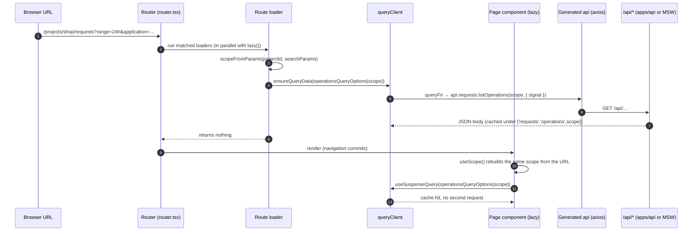
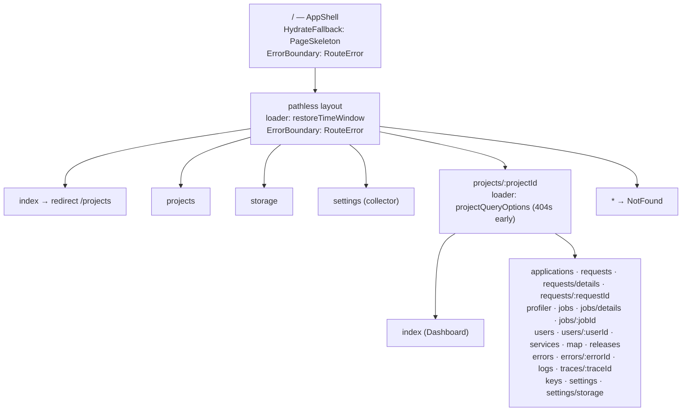
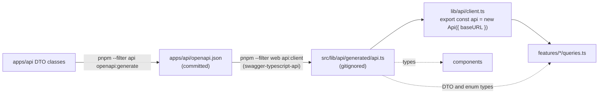
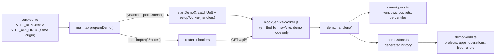

# Frontend architecture

How `apps/web`, the dashboard, is built and why. Read this before the code. For the day-to-day rules
(conventions, commands, the "add a page" recipe) the source of truth is
[apps/web/AGENTS.md](../../apps/web/AGENTS.md); this document explains the design behind them and
points there instead of repeating it.

## Big picture

The dashboard is a single-page app that reads the collector's **query API** (`/api/*`, served by
`apps/api`) and renders what instrumented NestJS apps sent: requests, jobs, errors, logs, traces,
runtime metrics, users, releases and storage. It never talks to the ingest endpoints and has no
login: whoever reaches it can use it.

| Concern      | Choice                                                                            |
| ------------ | --------------------------------------------------------------------------------- |
| Build        | Vite (`vite.config.ts`), TypeScript, `@` alias for `src/`                         |
| UI runtime   | React 19, `StrictMode`                                                            |
| Routing      | React Router v7 in **data mode** (`createBrowserRouter` + `RouterProvider`)       |
| Server state | TanStack Query v5, the only cache of API data                                     |
| HTTP         | axios client **generated** from `apps/api/openapi.json` (swagger-typescript-api)  |
| URL state    | Search params parsed with zod                                                     |
| Styling      | Tailwind CSS v4 (`@tailwindcss/vite`) + shadcn/ui components, theme tokens in CSS |
| Charts       | Recharts through shadcn's `ChartContainer`                                        |
| Demo         | Mock Service Worker (MSW), only in `--mode demo` builds                           |
| Tests        | Vitest, pure modules plus a few hook specs                                        |

Three decisions shape everything else:

1. **The URL is the state.** The project is in the path; the application, the time window and every
   page filter are search params. A link reproduces exactly what you see, the back button works, and
   loaders can fetch before the page renders because everything they need is in the request URL.
2. **The query cache is the single source of truth.** Loaders only warm it; components read it.
   There is no second copy of server data in loader results, context or component state.
3. **Types come from the API.** The client and every DTO type are generated from the OpenAPI spec,
   so a backend change that breaks the dashboard fails `typecheck` instead of failing in production.

### How a page gets its data



Because the loader and the component call the **same factory** with the **same scope**, they agree
on the query key by construction, and the component never suspends on a normal navigation. If the
cache is later invalidated (LIVE, the refresh button, a mutation), the component refetches on its
own, without the router.

## Source layout

```
apps/web/src/
  main.tsx          bootstrap: demo worker (demo builds), providers, RouterProvider
  router.tsx        queryClient singleton + the whole route tree
  index.css         Tailwind entry, theme tokens (light :root, dark .dark), a few custom classes
  features/<area>/  one folder per product area (requests, jobs, errors, logs, map, ...)
  components/       shared UI, no knowledge of a specific area
    ui/             shadcn/ui components, generated by the CLI
    layout/         app shell, nav, scope controls, global search, custom range picker
    data/           tables, filters, badges, metric cells, key/value lists, RelativeTime
    charts/         time-bucket charts, sparkline, tooltip, release markers
    trace/          trace waterfall, span helpers, error panel
    page.tsx, panel.tsx, states.tsx, scoped-link.tsx, route-error.tsx, not-found.tsx, ...
  lib/              framework-light helpers, mostly pure and unit-tested
    api/            client.ts, pagination.ts, scope.ts, generated/ (gitignored)
    scope-hooks.ts  URL-scope hooks (useScope, useTypedSearch, useScopedHref, ...)
    search.ts       zod helpers and search-param parsing/patching
    paths.ts        every pathname
    format.ts       number, duration, size and date formatting
    stats.ts        range math, previous window, throughput, trends
    time-window.ts  window bounds, labels and phrases
    stored-window.ts  remembering the last time window in localStorage
  demo/             MSW handlers and generated data (demo builds only)
```

What belongs where:

- **`features/<area>/`** holds everything specific to one area: `queries.ts` (query and mutation
  factories), `search.ts` (the page's zod search schema), pages (`*-page.tsx`), area components, and
  pure helpers (`*-math.ts`, `map-layout.ts`). Cross-cutting state also lives here as a feature:
  `features/live` (auto-refresh) and `features/theme`.
- **`components/`** is reusable UI. If a component imports from a feature's `queries.ts` it is
  usually a feature component; `components/layout/scope-controls.tsx` is the deliberate exception,
  since the header needs the application list.
- **`lib/`** has no JSX. Anything with logic worth testing goes here or in a feature's pure module,
  not inside a component.
- Hooks and constants live in their own files (`use-sorted-rows.ts`, `theme-context.ts`,
  `live-context.ts`) so component files only export components and Fast Refresh keeps working.

## Routing and data flow

All routes are declared in [`src/router.tsx`](../../apps/web/src/router.tsx) as one object tree.



### Loaders prefetch, components read

Every loader parses the request URL (`scopeFromParams`, `parseRequestSearch(schema, request)`) and
calls `queryClient.ensureQueryData(...)` or `ensureInfiniteQueryData(...)`, awaiting what the page
needs to render and returning nothing. Some details worth knowing:

- Secondary data is **not awaited**: the "previous period" overview used for trends is started with
  `void queryClient.prefetchQuery(previousOverviewQueryOptions(scope))`, and the project settings
  page does the same for its storage summary. The page then reads it with a non-suspense query.
- **Missing data is a 404, thrown early.** `param()` throws `new Response('Not found', { status: 404 })`
  for an absent route param, the `requests/details` and `jobs/details` loaders throw it when their
  required search params are missing, and the `projects/:projectId` loader fetches the project first
  so an unknown slug fails before any child loader runs.
- **Loaders may depend on data.** The profiler loader awaits the applications list to pick a
  default application, because runtime metrics are per application.
- The shared `queryClient` sets `staleTime: 30_000`, turns off refetch on window focus, and does not
  retry 4xx errors (a bad filter will not fix itself).

`useLoaderData` is never used. Keeping the loader result empty means there is only one way to read
data, and invalidation works the same everywhere.

### Lazy pages

Each route uses `lazy: async () => ({ Component: (await import('...')).XPage })`. React Router runs
the `lazy()` import in parallel with the loader, so code splitting costs no extra waterfall. Pages
are named exports; the dynamic import picks the one it needs.

### Loading, errors and not-found

- **First load**: the root route's `HydrateFallback: PageSkeleton` shows while the initial loaders
  run.
- **Navigations**: `AppShell` reads `useNavigation()` and, while it is not idle, shows a thin
  pending bar at the top of the header and dims `<main>` (after a 300 ms delay, so fast navigations
  do not flash). The old page stays on screen until the new one is ready.
- **Suspense**: `<Outlet />` is wrapped in `<Suspense fallback={<PageSkeleton />}>` as a safety net
  for any query that suspends outside a loader.
- **Errors**: the pathless layout route has `ErrorBoundary: RouteError`, so a failing page renders
  its error **inside** the shell (nav still usable). `RouteError` shows `NotFound` for a 404 route
  error response, otherwise `ErrorState` with a retry button that resets the TanStack Query error
  boundary and calls `revalidator.revalidate()`. The root route has the same boundary as a last
  resort for errors in the shell itself.
- **Unknown paths**: `{ path: '*', Component: NotFound }`.

### Restoring the time window

The pathless route's loader, `restoreTimeWindow`, makes the dashboard reopen on the window the user
picked last. `AppShell` calls `useStoreTimeWindow()`, which writes the current window to
localStorage (`observe-time-window`). When a URL arrives with no `range`, `from` or `to`,
`withStoredWindow` merges the stored window into the search params and the loader `redirect`s to
that URL (stripping the basename first, because `redirect` paths are relative to it). The default
window (`1h`) is never restored, so plain URLs stay plain. Because it is a redirect, the window is
always visible in the URL, and shared links still win over the stored value.

## Scope and URL state

ADR [0002](../adr/0002-application-scoping.md) defines projects and applications, and
[0007](../adr/0007-time-ranges.md) defines the time ranges and custom windows. On the client they
become a `Scope`, defined in [`lib/api/scope.ts`](../../apps/web/src/lib/api/scope.ts):

| Field         | Source                  | Notes                                                        |
| ------------- | ----------------------- | ------------------------------------------------------------ |
| `project`     | path `:projectId`       | slug or id                                                   |
| `application` | search `?application=`  | optional; absent means all applications                      |
| `range`       | search `?range=`        | one of `TIME_RANGES` (`1h` … `15d`), default `DEFAULT_RANGE` |
| `from`, `to`  | search `?from=`, `?to=` | custom window, ISO 8601 with offset; `from` wins over range  |

The field names match the API's query params, so a scope spreads straight into a call:
`api.requests.listOperations(scope, { signal })`. `scopeFromParams` validates with zod and falls back
to the preset for an invalid custom window (reversed, longer than `MAX_WINDOW_DAYS`, or `to` alone),
the same way every invalid param falls back instead of failing the page. With a custom window the
scope's `range` is pinned to the default so query keys do not vary on a value the API ignores.

Each project shows three quick ranges in its header (`rangePresets`, editable in project Settings,
read through `useRangePresets()`); `DEFAULT_RANGE_PRESETS` is `1h`, `24h`, `7d`. A shared link with a
preset outside those three still shows it as an extra segment.

### Keeping scope across navigation

`SCOPE_KEYS` (`application`, `range`, `from`, `to`) are global: they must survive moving between
pages. Plain `<Link to="/projects/x/jobs">` would drop them, so:

- `ScopedLink` / `ScopedNavLink` ([`components/scoped-link.tsx`](../../apps/web/src/components/scoped-link.tsx))
  take a pathname (from `paths`) plus an optional `search` patch and keep the scope keys.
- `useScopedNavigate()` does the same for imperative navigation, and `useScopedHref()` builds the
  string when you need an href.
- Pathnames come from [`lib/paths.ts`](../../apps/web/src/lib/paths.ts) (`paths.request(project, id)`,
  `paths.operation(project)` with `{ operationId, method }` as search, ...), never hand-built strings.

### Page filters

Each page with filters declares a zod object schema in `features/<area>/search.ts` using the helpers
in `lib/search.ts` (`optionalString`, `optionalNumber`, `optionalEnum`), which turn blank or invalid
values into `undefined`. The loader parses with `parseRequestSearch(schema, request)`; the page uses
`const [filters, setSearch] = useTypedSearch(schema)`, where `setSearch({ key: undefined })` removes a
key. This matters because the API rejects unknown or malformed query params: the schema is the
filter between an arbitrary URL and a valid request. Free-text inputs use `DebouncedInput` so typing
does not navigate (and refetch) on every keystroke.

The scope hooks (`useScope`, `useTimeWindow`) memoize on the raw strings of the scope keys only, so
changing an unrelated filter keeps the same scope object and does not churn memo dependencies.

### LIVE and refresh

`LiveProvider` ([`features/live/live-provider.tsx`](../../apps/web/src/features/live/live-provider.tsx))
wraps the shell. When LIVE is on (persisted as `observe-live`), it calls
`queryClient.invalidateQueries({ type: 'active' })` every 10 s while the tab is visible. Relative
ranges slide forward with each refetch. It pauses itself when:

- the window is fixed (`from` and `to` both set, `isFixedWindow`): nothing new can appear, so the
  LIVE pill is disabled with a tooltip explaining why;
- a page holds it with `useLiveHold()`: the request and job detail pages show one finished execution
  and have no LIVE control.

`RefreshButton` in `ScopeControls` invalidates the active queries once on demand. `ScopeControls`
groups the header controls: `ApplicationSelect`, `LivePill`, `RangeSegmented`, `CustomRangePicker`
and `RefreshButton`.

## Server state

### Query factories

Components never call `api`, axios or `fetch`. Each feature's `queries.ts` exports factories built
with `queryOptions` / `infiniteQueryOptions` / `mutationOptions`:

```ts
export const operationsQueryOptions = (scope: Scope) =>
  queryOptions({
    queryKey: ['requests', 'operations', scope],
    queryFn: ({ signal }) => api.requests.listOperations(scope, { signal }),
  });
```

- **Keys** start with the area, then the kind, then everything the result depends on:
  `['requests', 'list', scope, filters]`. Including the whole scope object means a change of
  application or window is a different cache entry, and invalidating `['api-keys']` hits every
  api-keys query regardless of project.
- **Signals** are always passed, so a navigation away cancels in-flight requests.
- **Immutable data** gets `staleTime: Infinity` (a finished request's detail never changes).
- **Paged lists** use `pagedQueryOptions(queryKey, fetchPage)` from `lib/api/pagination.ts` for
  cursor endpoints returning `{ items, nextCursor }`, with `PAGE_SIZE` 50. Loaders call
  `ensureInfiniteQueryData`, pages use `useSuspenseInfiniteQuery`, and `LoadMore` goes in the
  `TableFrame` footer.

### Mutations

Mutations (projects, applications, API keys, range presets, self-observe, storage trims, update check) are
`mutationOptions` factories in the same `queries.ts`. The component spreads one into `useMutation`
and adds the UI reactions: invalidate the affected keys, then `toast.success(...)` (sonner, mounted
once in `main.tsx`). Validation errors from the API are shown in the dialog with `FormError`, which
uses `errorMessage()` from `lib/api/client.ts` to read Nest's `{ message }` body.

### The generated client



The web package's `dev`, `build`, `typecheck` and `test` scripts all run `api:client` first, so the
generated file always matches the committed spec. Root `pnpm api:generate` runs both steps. Methods
are grouped by resource and return the body directly (`--unwrap-response-data`); enums are string
unions. Never hand-write an API type: if the dashboard needs a field, the backend adds it to the DTO
and regenerates the spec.

`API_URL` comes from `VITE_API_URL` (default `http://localhost:3000`). An empty value means same
origin, which is what the Docker image builds with because the API serves the dashboard there.

## UI system

### Theme tokens

[`src/index.css`](../../apps/web/src/index.css) defines every color as a CSS variable with a light
value on `:root` and a dark value on `.dark`, and maps them to Tailwind colors in `@theme inline`
(so `bg-card`, `text-status-error`, `border-map-frame` all work). Beyond the shadcn set there are
dashboard tokens: `--chart-1..5`, `--status-ok|warn|error`, `--span-db|http|code`, `--usage-1..3`,
`--rail`, `--card-header`, `--bar`, `--teal` and a `--map-*` family. Components use tokens, never
literal colors, which is what keeps light mode working although the design is dark first.

The theme (`light`, `dark` or `system`, default dark) is owned by `ThemeProvider`, stored as
`observe-theme`, and applied as the `dark` class on `<html>`. An inline script in `index.html`
applies it before first paint to avoid a light flash.

### Composition

Pages are assembled from small layout components rather than configured through props:

```tsx
<Page>
  <PageHeader>
    <ProjectTitle subtitle="…">Map</ProjectTitle>
    <ScopeControls />
  </PageHeader>
  <PanelGrid>
    <Panel>
      <PanelHeader title="Requests" aside={<LegendChip … />}>
        <CountBadge>…</CountBadge>
      </PanelHeader>
      <PanelBody>…</PanelBody>
    </Panel>
  </PanelGrid>
</Page>
```

`components/page.tsx` has `Page`, `PageHeader`, `PageTitle`, `PageActions`, `PageSection` and
`PanelGrid`; `components/panel.tsx` has `Panel`, `PanelHeader`, `PanelBody`, `CountBadge`,
`LegendChip`, `ChartCaption`, `ChartRange`, `BigNumber`, `FigureDetail` and `Trend`. Detail pages use
`KeyValueList` + `KeyValue`. States come from `components/states.tsx`: `PageSkeleton`, `ErrorState`,
`EmptyState` and `NoTelemetryHint`. This follows the `composition-patterns` skill: explicit children
and slots instead of boolean props.

### Tables

Tables are shadcn `<Table>`s inside `TableFrame` (`components/data/data-table.tsx`), which gives the
card, mono uppercase headers and row height. A clickable row is a `LinkRow` with one
`<ScopedLink className={stretchedLink}>` in a cell: the link's `::after` covers the row, so the row
is a real link (middle-click, keyboard focus, copy address) instead of an `onClick` handler. Any other
interactive element in the row needs `relative z-10` to sit above the stretched link. Numeric cells
use `NumCell`; sorting is `SortableHead` plus `useSortedRows`.

`RelativeTime` renders a `<time>` with "5 minutes ago" (`formatRelative`) and the full date as its
`title`. It carries `relative z-10` for exactly the reason above: otherwise the stretched link would
swallow the hover. It does not tick on its own; it updates when its row re-renders (for example on a
LIVE refetch).

### Charts

Charts live in `components/charts/` (`RequestBarsChart`, `JobBarsChart`, `DurationChart`,
`ErrorStemChart`, `Sparkline`) and in feature folders when specific to one page. Conventions:

- Always wrap Recharts in shadcn's `ChartContainer` with a `ChartConfig`; colors are `var(--token)`
  or a `color-mix` of tokens, so they follow the theme.
- One y-axis per chart; split measures into separate charts.
- Tooltips use the shared `chartTooltip(config, format)`; values go through `lib/format.ts`.
- Release markers are drawn by `ChartMarkers`, positioned by the pure `placeMarkers` in
  `marker-placement.ts`.
- Status colors always come with a label or icon, never color alone.

### Worked example: the Map page

The Map (`features/map/`) is a custom SVG visualization with no graph library, and shows how to
split such a feature:

| File                             | Role                                                                                                                                                                                                                                                                          |
| -------------------------------- | ----------------------------------------------------------------------------------------------------------------------------------------------------------------------------------------------------------------------------------------------------------------------------- |
| `queries.ts`                     | `mapQueryOptions(scope)` → `api.map.getMap`                                                                                                                                                                                                                                   |
| `map-layout.ts`                  | **Pure** layout: `layoutMap(nodes, edges, { width, measure })` returns node positions, edge paths, columns and size. A small Sugiyama: columns by longest path, dummy lanes for long links, barycenter sweeps to reduce crossings. Constants in `MAP_SIZES` and `ICON_SIZES`. |
| `map-layout.spec.ts`             | Unit tests of the layout (columns, hanging nodes, lanes, crossings, label clearance)                                                                                                                                                                                          |
| `map-style.ts`                   | Pure styling decisions: `healthOf`, `nodeTone`, `edgeColors`, `edgeWidth`, icons, labels, `measureNodeText`                                                                                                                                                                   |
| `map-graph.tsx`                  | `MapGraph`: measures its width with `useElementWidth`, memoizes `layoutMap`, draws edges as SVG paths under HTML nodes                                                                                                                                                        |
| `map-legend.tsx`, `map-page.tsx` | Legend and the page (`useSuspenseQuery`, `EmptyState` with `NoTelemetryHint`)                                                                                                                                                                                                 |

The rule it demonstrates: geometry and decisions are plain functions of data (testable in node
without a DOM), and components only measure, memoize and render. Colors are `--map-*` tokens, so the
map has light and dark variants like everything else.

## Demo mode

The demo runs the real dashboard with no backend, for GitHub Pages and quick local exploration.



- `world.ts` describes a fictional setup; `store.ts` generates `HISTORY_DAYS` of telemetry from it
  with a seeded RNG (`random.ts`) and keeps extending it as time passes (`catchUp()`), so LIVE shows
  new data. `handlers/` (telemetry, map, releases, management, updates, self-observe) mirror the
  query API using the generated DTO types. When the API adds or changes an endpoint, its handler must
  follow.
- Ordering matters: `main.tsx` awaits the worker **before** importing `router.tsx`, because creating
  the router starts the first loaders immediately.
- The demo code is only reachable through the `VITE_DEMO` check and a dynamic import, and the MSW
  Vite plugin only applies in `demo` mode, so normal builds contain neither. `DemoBanner` marks the
  page as generated data.
- **Basename.** `BASE_PATH` sets Vite's `base`; `router.tsx` derives `BASENAME` from
  `import.meta.env.BASE_URL` and passes it to `createBrowserRouter`, and the worker URL is built from
  the same base. The `Demo (GitHub Pages)` workflow (`.github/workflows/demo.yml`, manual only) builds
  with `BASE_PATH=/<repo>/` and copies `index.html` to `404.html` because Pages has no SPA fallback.

Commands are in [apps/web/AGENTS.md](../../apps/web/AGENTS.md#demo-mode) (`dev:demo`, `build:demo`,
`preview:demo`).

## Testing strategy

Unit tests only, with Vitest (repo-wide rule in [AGENTS.md](../../AGENTS.md#rules)).
`vitest.config.ts` reuses `vite.config.ts` and pins `TZ=UTC` so date formatting is deterministic.

| What                                       | How                                                                     | Examples                                                                                            |
| ------------------------------------------ | ----------------------------------------------------------------------- | --------------------------------------------------------------------------------------------------- |
| `lib/` helpers                             | Node, plain functions                                                   | `format`, `stats`, `paths`, `search`, `time-window`, `stored-window`, `api/scope`, `api/pagination` |
| Feature pure modules (`*-math.ts`, layout) | Node                                                                    | `release-math`, `storage-math`, `users-math`, `project-order`, `map-layout`                         |
| Search schemas                             | Node, parse URLs                                                        | `features/search-schemas.spec.ts`, `services/search.spec.ts`                                        |
| Hooks                                      | `// @vitest-environment jsdom`, `renderHook` under `createMemoryRouter` | `lib/scope-hooks.spec.tsx`                                                                          |

Not tested: shadcn/ui components, page components and visual output (checked in a browser with the
Playwright MCP instead), and the generated client, which is never mocked. This is why logic is pushed
out of components into `lib/` and `*-math.ts` modules: that is where tests can reach it cheaply.

## How to add a new page

The canonical recipe is [apps/web/AGENTS.md → Add a page](../../apps/web/AGENTS.md#add-a-page). In
short:

1. Check the endpoint exists in `apps/api/openapi.json`; if not, ask the backend owner, then run
   `pnpm --filter web api:client`.
2. Add a factory to `features/<area>/queries.ts`: area-first key with the scope and filters,
   `api.<resource>.<method>(…, { signal })`. Use `pagedQueryOptions` for cursor lists.
3. If the page has filters, add a zod schema to `features/<area>/search.ts` (and cover it in a spec).
4. Add the pathname to `lib/paths.ts`.
5. Build `features/<area>/<name>-page.tsx`: `useScope()`, `useTypedSearch(schema)`,
   `useSuspenseQuery(factory(…))`, `Page` / `PageHeader` / `ProjectTitle` / `ScopeControls`, panels,
   and an `EmptyState` (with `NoTelemetryHint` when nothing matches without filters).
6. Add the route under `projects/:projectId` (or the pathless layout) in `router.tsx`: a loader that
   parses the same scope and search and calls `ensureQueryData` with the same factory, and a `lazy`
   import of the page.
7. Link to it with `ScopedLink` / `ScopedNavLink`; add a nav entry in
   `components/layout/app-nav.tsx` if it is a top-level area.
8. Add a demo handler in `src/demo/handlers/` if the endpoint is new.
9. Move any non-trivial logic into a pure module and test it; run `pnpm --filter web build`,
   `typecheck`, `lint`, `test` and `pnpm format`.
